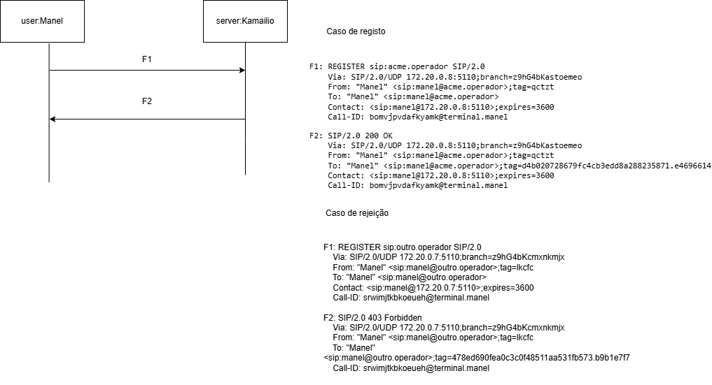

# US1 – Rejeitar registos de domínios externos: Acceptance Criteria e Definition of Done

**User story:** Como operador, quero rejeitar pedidos de registo de domínios que não sejam acme.operador, para que só utilizadores do operador possam usar o ConferenceControl 2.0.

**Requisito (§2 do enunciado):** "rejeitar, usando resposta SIP adequada, registos cuja rede (domínio) não seja acme.operador"

## Acceptance Criteria

| # | Critério | Resultado |
| --- | --- | --- |
| AC1 | REGISTER com domínio diferente de `acme.operador` → 403 Forbidden (sem registo) | ✅ T1 |
| AC2 | REGISTER com domínio `acme.operador` não é bloqueado → segue para o registo (200 OK) | ✅ T2 |

## Diagrama de estados


## Diagrama de sequência



## Transações e diálogos

Cada REGISTER e a sua resposta final formam **uma transação não-INVITE**, identificada pelo `branch` do Via (e pelo CSeq). **Nenhum REGISTER cria diálogo:** o To-tag na resposta é gerado pelo Kamailio, mas não existe diálogo entre o UA e o registrar. Como não há ACK para respostas a pedidos não-INVITE, cada cenário tem apenas duas mensagens. O `Call-ID` identifica o registo do utilizador e o CSeq aumenta a cada pedido.

| Transação | Cenário | CSeq | Branch (Via) | Mensagens | Resposta final | Duração no servidor (pedido → resposta) |
| --- | --- | --- | --- | --- | --- | --- |
| T1 | Domínio externo (`outro.operador`) | 942 | `z9hG4bKcmxnkmjx` | F1–F2 | 403 Forbidden | 1,97 ms |
| T2 | Domínio `acme.operador` | 482 | `z9hG4bKastoemeo` | F3–F4 | 200 OK | 4,79 ms |

O Kamailio responde de forma imediata (o `sl.send_reply()` responde sem estado). Do lado do UA, a transação cliente termina após o Timer K (5 s em UDP) depois de receber a resposta final.

## Mensagens (capturas reais)

Valores retirados das capturas em `tests/US1/` (F1–F2 de `captura_rejeitada.pcap`; F3–F4 de `captura_registada.pcap`).

**F1** (captura_rejeitada.pcap)
```
REGISTER sip:outro.operador SIP/2.0
Via: SIP/2.0/UDP 172.20.0.7:5110;rport;branch=z9hG4bKcmxnkmjx
Max-Forwards: 70
To: "Manel" <sip:manel@outro.operador>
From: "Manel" <sip:manel@outro.operador>;tag=lkcfc
Call-ID: srwimjtkbkoeueh@terminal.manel
CSeq: 942 REGISTER
Contact: <sip:manel@172.20.0.7:5110>;expires=3600
Allow: INVITE,ACK,BYE,CANCEL,OPTIONS,PRACK,REFER,NOTIFY,SUBSCRIBE,INFO,MESSAGE
User-Agent: Twinkle/1.11.0-devel
Content-Length: 0
```

**F2** (captura_rejeitada.pcap)
```
SIP/2.0 403 Forbidden
Via: SIP/2.0/UDP 172.20.0.7:5110;rport=5110;received=172.20.0.7;branch=z9hG4bKcmxnkmjx
To: "Manel" <sip:manel@outro.operador>;tag=478ed690fea0c3c0f48511aa531fb573.b9b1e7f7
From: "Manel" <sip:manel@outro.operador>;tag=lkcfc
Call-ID: srwimjtkbkoeueh@terminal.manel
CSeq: 942 REGISTER
Server: kamailio (6.0.3 (x86_64/linux))
Content-Length: 0
```

**F3** (captura_registada.pcap)
```
REGISTER sip:acme.operador SIP/2.0
Via: SIP/2.0/UDP 172.20.0.8:5110;rport;branch=z9hG4bKastoemeo
Max-Forwards: 70
To: "Manel" <sip:manel@acme.operador>
From: "Manel" <sip:manel@acme.operador>;tag=qctzt
Call-ID: bomvjpvdafkyamk@terminal.manel
CSeq: 482 REGISTER
Contact: <sip:manel@172.20.0.8:5110>;expires=3600
Allow: INVITE,ACK,BYE,CANCEL,OPTIONS,PRACK,REFER,NOTIFY,SUBSCRIBE,INFO,MESSAGE
User-Agent: Twinkle/1.11.0-devel
Content-Length: 0
```

**F4** (captura_registada.pcap)
```
SIP/2.0 200 OK
Via: SIP/2.0/UDP 172.20.0.8:5110;rport=5110;received=172.20.0.8;branch=z9hG4bKastoemeo
To: "Manel" <sip:manel@acme.operador>;tag=d4b020728679fc4cb3edd8a288235871.e4696614
From: "Manel" <sip:manel@acme.operador>;tag=qctzt
Call-ID: bomvjpvdafkyamk@terminal.manel
CSeq: 482 REGISTER
Contact: <sip:manel@172.20.0.8:5110>;expires=3600
Server: kamailio (6.0.3 (x86_64/linux))
Content-Length: 0
```
