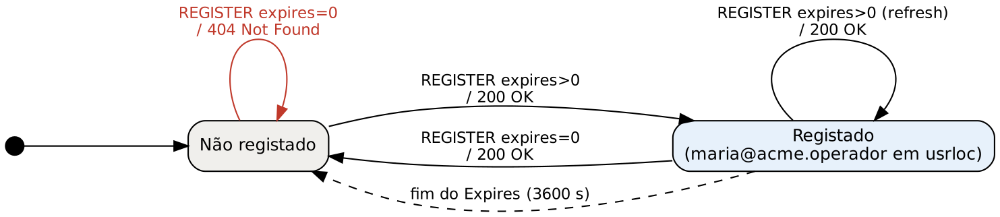
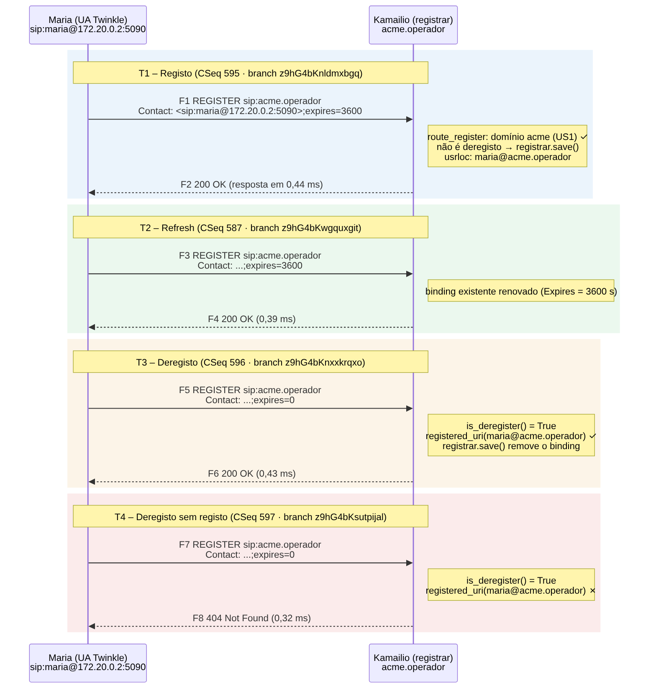

# US2 – Registo e deregisto: Acceptance Criteria e Definition of Done

**User story:** Como colaborador, quero registar-me e deregistar-me em acme.operador, para poder usar o ConferenceControl 2.0.

**Requisito (§2 do enunciado):** "efetuar, enviando resposta SIP de sucesso, registo e deregisto de utilizadores do domínio acme.operador, atualizando a base de dados de registos".

## Acceptance Criteria

| # | Critério | Resultado |
| --- | --- | --- |
| AC1 | REGISTER de utilizador acme com expires > 0 → 200 OK e AoR `maria@acme.operador` na base de dados de registos (usrloc) | ✅ T1, `ul.dump` com 1 registo |
| AC2 | REGISTER de utilizador já registado (refresh) → 200 OK e Expires renovado | ✅ T2 |
| AC3 | REGISTER com expires = 0 de utilizador registado → 200 OK e AoR removido | ✅ T3, `ul.dump` com 0 registos |
| AC4 | REGISTER com expires = 0 de utilizador não registado → 404 Not Found | ✅ T4 |

## Diagrama de estados



## Diagrama de sequência



## Transações e diálogos

Cada REGISTER e a sua resposta final formam **uma transação não-INVITE**, identificada pelo `branch` do Via (e pelo CSeq). **Nenhum REGISTER cria diálogo:** o To-tag na resposta é gerado pelo Kamailio, mas não existe diálogo entre o UA e o registrar. O `Call-ID` (`skeeszycczdxhvh@terminal.maria`) mantém-se em todos os pedidos e identifica o registo da Maria; o CSeq aumenta a cada pedido. O registo (binding) dura o tempo do Expires (3600 s) ou até ao deregisto.

| Transação | Cenário | CSeq | Branch (Via) | Mensagens | Resposta final | Duração no servidor (pedido → resposta) |
| --- | --- | --- | --- | --- | --- | --- |
| T1 | Registo | 595 | `z9hG4bKnldmxbgq` | F1–F2 | 200 OK | 0,44 ms |
| T2 | Refresh | 587 | `z9hG4bKwgquxgit` | F3–F4 | 200 OK | 0,39 ms |
| T3 | Deregisto | 596 | `z9hG4bKnxxkrqxo` | F5–F6 | 200 OK | 0,43 ms |
| T4 | Deregisto sem registo | 597 | `z9hG4bKsutpijal` | F7–F8 | 404 Not Found | 0,32 ms |

O Kamailio responde de forma imediata (o `registrar.save()` e o `sl.send_reply()` respondem sem estado). Do lado do UA, a transação cliente termina após o Timer K (5 s em UDP) depois de receber a resposta final.

## Mensagens (capturas reais)

Valores retirados das capturas em `tests/US2/` (F1, F2 e F5–F8 de `us2_deregisto_404.pcapng`; F3–F4 de `us2_refresh.pcapng`).

**F1** (us2_deregisto_404.pcapng)
```
REGISTER sip:acme.operador SIP/2.0
Via: SIP/2.0/UDP 172.20.0.2:5090;rport;branch=z9hG4bKnldmxbgq
Max-Forwards: 70
To: "Maria" <sip:maria@acme.operador>
From: "Maria" <sip:maria@acme.operador>;tag=ngzvo
Call-ID: skeeszycczdxhvh@terminal.maria
CSeq: 595 REGISTER
Contact: <sip:maria@172.20.0.2:5090>;expires=3600
Allow: INVITE,ACK,BYE,CANCEL,OPTIONS,PRACK,REFER,NOTIFY,SUBSCRIBE,INFO,MESSAGE
User-Agent: Twinkle/1.11.0-devel
Content-Length: 0
```
**F2** (us2_deregisto_404.pcapng)
```
SIP/2.0 200 OK
Via: SIP/2.0/UDP 172.20.0.2:5090;rport=5090;received=172.20.0.2;branch=z9hG4bKnldmxbgq
To: "Maria" <sip:maria@acme.operador>;tag=d7c5775fc8bf047833cfcbc8dda76893.ba316876
From: "Maria" <sip:maria@acme.operador>;tag=ngzvo
Call-ID: skeeszycczdxhvh@terminal.maria
CSeq: 595 REGISTER
Contact: <sip:maria@172.20.0.2:5090>;expires=3600
Server: kamailio (6.0.3 (x86_64/linux))
Content-Length: 0
```
**F3** (us2_refresh.pcapng)
```
REGISTER sip:acme.operador SIP/2.0
Via: SIP/2.0/UDP 172.20.0.2:5090;rport;branch=z9hG4bKwgquxgit
Max-Forwards: 70
To: "Maria" <sip:maria@acme.operador>
From: "Maria" <sip:maria@acme.operador>;tag=fcnzn
Call-ID: skeeszycczdxhvh@terminal.maria
CSeq: 587 REGISTER
Contact: <sip:maria@172.20.0.2:5090>;expires=3600
Allow: INVITE,ACK,BYE,CANCEL,OPTIONS,PRACK,REFER,NOTIFY,SUBSCRIBE,INFO,MESSAGE
User-Agent: Twinkle/1.11.0-devel
Content-Length: 0
```
**F4** (us2_refresh.pcapng)
```
SIP/2.0 200 OK
Via: SIP/2.0/UDP 172.20.0.2:5090;rport=5090;received=172.20.0.2;branch=z9hG4bKwgquxgit
To: "Maria" <sip:maria@acme.operador>;tag=d7c5775fc8bf047833cfcbc8dda76893.50ed6876
From: "Maria" <sip:maria@acme.operador>;tag=fcnzn
Call-ID: skeeszycczdxhvh@terminal.maria
CSeq: 587 REGISTER
Contact: <sip:maria@172.20.0.2:5090>;expires=3600
Server: kamailio (6.0.3 (x86_64/linux))
Content-Length: 0
```
**F5** (us2_deregisto_404.pcapng)
```
REGISTER sip:acme.operador SIP/2.0
Via: SIP/2.0/UDP 172.20.0.2:5090;rport;branch=z9hG4bKnxxkrqxo
Max-Forwards: 70
To: "Maria" <sip:maria@acme.operador>
From: "Maria" <sip:maria@acme.operador>;tag=trlhc
Call-ID: skeeszycczdxhvh@terminal.maria
CSeq: 596 REGISTER
Contact: <sip:maria@172.20.0.2:5090>;expires=0
Allow: INVITE,ACK,BYE,CANCEL,OPTIONS,PRACK,REFER,NOTIFY,SUBSCRIBE,INFO,MESSAGE
User-Agent: Twinkle/1.11.0-devel
Content-Length: 0
```
**F6** (us2_deregisto_404.pcapng)
```
SIP/2.0 200 OK
Via: SIP/2.0/UDP 172.20.0.2:5090;rport=5090;received=172.20.0.2;branch=z9hG4bKnxxkrqxo
To: "Maria" <sip:maria@acme.operador>;tag=d7c5775fc8bf047833cfcbc8dda76893.138d6876
From: "Maria" <sip:maria@acme.operador>;tag=trlhc
Call-ID: skeeszycczdxhvh@terminal.maria
CSeq: 596 REGISTER
Server: kamailio (6.0.3 (x86_64/linux))
Content-Length: 0
```
**F7** (us2_deregisto_404.pcapng)
```
REGISTER sip:acme.operador SIP/2.0
Via: SIP/2.0/UDP 172.20.0.2:5090;rport;branch=z9hG4bKsutpijal
Max-Forwards: 70
To: "Maria" <sip:maria@acme.operador>
From: "Maria" <sip:maria@acme.operador>;tag=xtemu
Call-ID: skeeszycczdxhvh@terminal.maria
CSeq: 597 REGISTER
Contact: <sip:maria@172.20.0.2:5090>;expires=0
Allow: INVITE,ACK,BYE,CANCEL,OPTIONS,PRACK,REFER,NOTIFY,SUBSCRIBE,INFO,MESSAGE
User-Agent: Twinkle/1.11.0-devel
Content-Length: 0
```
**F8** (us2_deregisto_404.pcapng)
```
SIP/2.0 404 Not Found
Via: SIP/2.0/UDP 172.20.0.2:5090;rport=5090;received=172.20.0.2;branch=z9hG4bKsutpijal
To: "Maria" <sip:maria@acme.operador>;tag=d7c5775fc8bf047833cfcbc8dda76893.61a06876
From: "Maria" <sip:maria@acme.operador>;tag=xtemu
Call-ID: skeeszycczdxhvh@terminal.maria
CSeq: 597 REGISTER
Server: kamailio (6.0.3 (x86_64/linux))
Content-Length: 0
```
