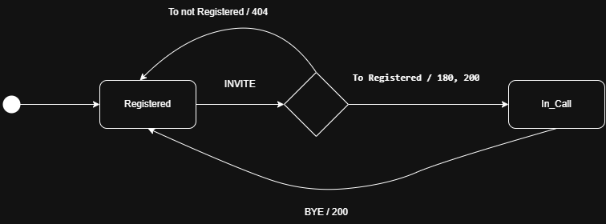
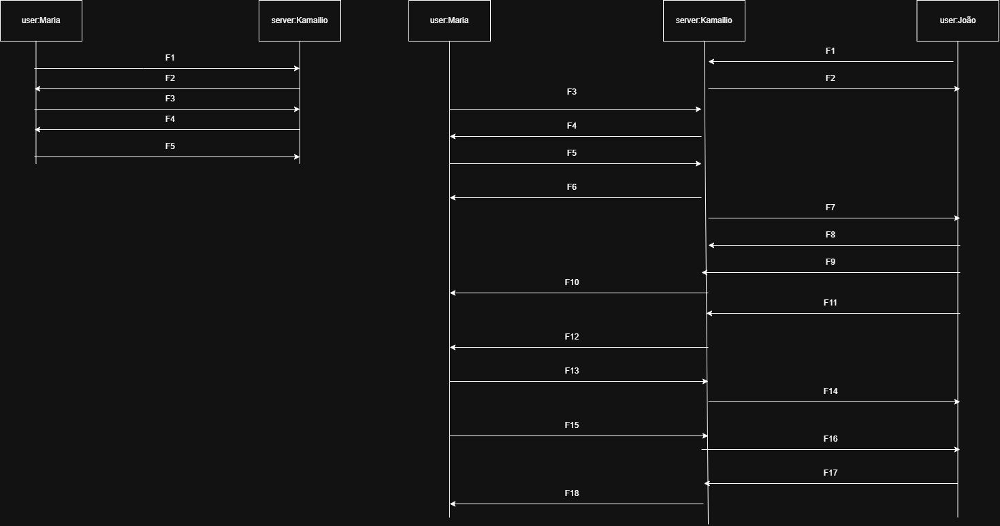
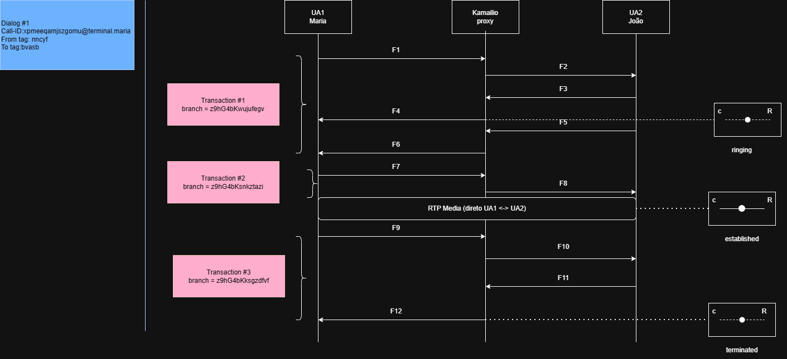

# US3 – Estabelecer e terminar chamadas de voz: Acceptance Criteria e Definition of Done

**User story:** Como colaborador, quero estabelecer e terminar chamadas de voz com colegas, para comunicar com a equipa.

**Requisito (§2 do enunciado):** "Estabelecer e terminar sessões de voz entre utilizadores da rede acme.operador. As respostas devem ser adequadas dependendo do estado de registo do destinatário."

## Acceptance Criteria

| # | Critério | Resultado |
| --- | --- | --- |
| AC1 | INVITE para utilizador registado → chamada estabelecida (180, 200, ACK) | ✅ T1 e T2 |
| AC2 | INVITE para utilizador não registado → 404 Not Found | ✅ T4 |
| AC3 | BYE termina a chamada (200 OK), passando pelo Kamailio (Record-Route) | ✅ T3 |

## Diagrama de estados



## Diagrama de sequência de mensagens

O diagrama tem dois casos:

- **Caso registado + BYE (F1–F18):** Joao e Maria registam-se (F1–F4, pré-condição documentada na US2); Maria liga ao Joao através do Kamailio (F5–F14) e termina a chamada (F15–F18).
- **Caso não registado (F1–F5):** Maria regista-se (F1–F2), liga ao Joao, que não está registado, e recebe 404 (F3–F5).



## Connection State View

Chamada entre UA1 (Maria) e UA2 (Joao) através do Kamailio (proxy), com o Dialog #1 e as três transações anotadas. Esta usa uma numeração própria (F1–F12, sem os `100 Trying` nem os registos), que corresponde ao diagrama de sequência do caso registado assim:

| Connection State View | F1 | F2 | F3 | F4 | F5 | F6 | F7 | F8 | F9 | F10 | F11 | F12 |
| --- | --- | --- | --- | --- | --- | --- | --- | --- | --- | --- | --- | --- |
| Diagrama de sequência | F5 | F7 | F9 | F10 | F11 | F12 | F13 | F14 | F15 | F16 | F17 | F18 |



Estados da ligação:
- **ringing (após F4):** sinalização em curso, ainda sem media.
- **established (após F8):** RTP direto entre UA1 (`172.20.0.2:8010`) e UA2 (`172.20.0.7:8020`). O Kamailio é proxy e não passa pelo media.
- **terminated (após F12):** ligação terminada.

## Transações e diálogos

**Diálogo #1** (chamada Maria → Joao): `Call-ID: xpmeeqamjszgomu@terminal.maria`, From-tag `nncyf`, To-tag `bvasb`. Fica estabelecido com o `200 OK` ao INVITE (F11–F12) e termina com o BYE (F15–F18). O Kamailio fica no caminho da sinalização através do `Record-Route: <sip:172.20.0.3;lr;ftag=nncyf>`, e o ACK e o BYE seguem por ele através do `Route`.

**Chamada a utilizador não registado (T4):** o 404 é uma resposta final não-2xx, por isso **não cria diálogo** (o To-tag existe, mas não há diálogo). O ACK ao 404 pertence à **mesma transação** do INVITE (mesmo `branch`), ao contrário do ACK a um 2xx, que é uma transação nova (T2).

**Pré-condição:** os REGISTER de Joao e Maria (F1–F4 do caso registado e F1–F2 do caso não registado) são transações não-INVITE sem diálogo, documentadas na US2.

| Transação | Cenário | CSeq | Branch (Via, lado UA1) | Mensagens | Resposta final | Duração no servidor (pedido → resposta) |
| --- | --- | --- | --- | --- | --- | --- |
| T1 | INVITE a utilizador registado | 688 INVITE | `z9hG4bKwujufegv` | F5–F12 | 200 OK | INVITE → 180: 9,74 ms; INVITE → 200: 25,45 s (tempo até o Joao atender) |
| T2 | ACK ao 200 OK | 688 ACK | `z9hG4bKsnkztazi` | F13–F14 | — (o ACK não tem resposta) | — |
| T3 | BYE | 689 BYE | `z9hG4bKksgzdfvf` | F15–F18 | 200 OK | 1,57 ms |
| T4 | INVITE a utilizador não registado | 241 INVITE | `z9hG4bKtncntsvy` | F3–F5 (caso não registado) | 404 Not Found | 1,22 ms |

As transações T1 a T3 correspondem a Transaction #1, #2 e #3 do Connection State View. O Kamailio gera um `branch` próprio para cada pedido que reencaminha ao Joao (F7: `z9hG4bK61fc.70c37af0…`, F14: `z9hG4bK61fc.82e0ed4b…`, F16: `z9hG4bK51fc.aa00312b…`). Por isso, cada pedido do UA1 corresponde a duas transações, uma de cada lado do proxy; a tabela mostra a do lado do UA1.

## Mensagens (capturas reais)

Valores retirados das capturas em `tests/US3/` (caso registado + BYE: `captura_registado_BYE.pcap`; caso não registado: `captura_nao_registado.pcap`).

### Caso registado + BYE

Registo de Joao e Maria (F1–F4, pré-condição):

**F1** (captura_registado_BYE.pcap)
```
REGISTER sip:acme.operador SIP/2.0
Via: SIP/2.0/UDP 172.20.0.7:5100;rport;branch=z9hG4bKdqnenujf
Max-Forwards: 70
To: "Joao" <sip:joao@acme.operador>
From: "Joao" <sip:joao@acme.operador>;tag=abiwg
Call-ID: cyqgyvkestoiavi@terminal.joao
CSeq: 506 REGISTER
Contact: <sip:joao@172.20.0.7:5100>;expires=3600
Allow: INVITE,ACK,BYE,CANCEL,OPTIONS,PRACK,REFER,NOTIFY,SUBSCRIBE,INFO,MESSAGE
User-Agent: Twinkle/1.11.0-devel
Content-Length: 0
```

**F2** (captura_registado_BYE.pcap)
```
SIP/2.0 200 OK
Via: SIP/2.0/UDP 172.20.0.7:5100;rport=5100;received=172.20.0.7;branch=z9hG4bKdqnenujf
To: "Joao" <sip:joao@acme.operador>;tag=b4f516ba9065625c22bc328d471b34f4.09a5f709
From: "Joao" <sip:joao@acme.operador>;tag=abiwg
Call-ID: cyqgyvkestoiavi@terminal.joao
CSeq: 506 REGISTER
Contact: <sip:joao@172.20.0.7:5100>;expires=3600
Server: kamailio (6.0.3 (x86_64/linux))
Content-Length: 0
```

**F3** (captura_registado_BYE.pcap)
```
REGISTER sip:acme.operador SIP/2.0
Via: SIP/2.0/UDP 172.20.0.2:5090;rport;branch=z9hG4bKyoiwltkq
Max-Forwards: 70
To: "Maria" <sip:maria@acme.operador>
From: "Maria" <sip:maria@acme.operador>;tag=bglqy
Call-ID: wuhoeugtslxvklx@terminal.maria
CSeq: 392 REGISTER
Contact: <sip:maria@172.20.0.2:5090>;expires=3600
Allow: INVITE,ACK,BYE,CANCEL,OPTIONS,PRACK,REFER,NOTIFY,SUBSCRIBE,INFO,MESSAGE
User-Agent: Twinkle/1.11.0-devel
Content-Length: 0
```

**F4** (captura_registado_BYE.pcap)
```
SIP/2.0 200 OK
Via: SIP/2.0/UDP 172.20.0.2:5090;rport=5090;received=172.20.0.2;branch=z9hG4bKyoiwltkq
To: "Maria" <sip:maria@acme.operador>;tag=b4f516ba9065625c22bc328d471b34f4.52afdc35
From: "Maria" <sip:maria@acme.operador>;tag=bglqy
Call-ID: wuhoeugtslxvklx@terminal.maria
CSeq: 392 REGISTER
Contact: <sip:maria@172.20.0.2:5090>;expires=3600
Server: kamailio (6.0.3 (x86_64/linux))
Content-Length: 0
```

Chamada, ACK e BYE (F5–F18). Cada mensagem indica o número que tem no Connection State View; os `100 Trying` (F6 e F8) não aparecem nessa vista:

**F5 (Connection State View: F1)** (captura_registado_BYE.pcap)
```
INVITE sip:joao@acme.operador SIP/2.0
Via: SIP/2.0/UDP 172.20.0.2:5090;rport;branch=z9hG4bKwujufegv
Max-Forwards: 70
To: <sip:joao@acme.operador>
From: "Maria" <sip:maria@acme.operador>;tag=nncyf
Call-ID: xpmeeqamjszgomu@terminal.maria
CSeq: 688 INVITE
Contact: <sip:maria@172.20.0.2:5090>
Content-Type: application/sdp
Allow: INVITE,ACK,BYE,CANCEL,OPTIONS,PRACK,REFER,NOTIFY,SUBSCRIBE,INFO,MESSAGE
Supported: replaces,norefersub,timer,100rel
User-Agent: Twinkle/1.11.0-devel
Content-Length: 250

v=0
o=twinkle 1660906120 2096946791 IN IP4 172.20.0.2
s=-
c=IN IP4 172.20.0.2
t=0 0
m=audio 8010 RTP/AVP 8 0 3 101
a=rtpmap:8 PCMA/8000
a=rtpmap:0 PCMU/8000
a=rtpmap:3 GSM/8000
a=rtpmap:101 telephone-event/8000
a=fmtp:101 0-15
a=ptime:20
```

**F6 (não representado no Connection State View)** (captura_registado_BYE.pcap)
```
SIP/2.0 100 trying -- your call is important to us
Via: SIP/2.0/UDP 172.20.0.2:5090;rport=5090;received=172.20.0.2;branch=z9hG4bKwujufegv
To: <sip:joao@acme.operador>
From: "Maria" <sip:maria@acme.operador>;tag=nncyf
Call-ID: xpmeeqamjszgomu@terminal.maria
CSeq: 688 INVITE
Server: kamailio (6.0.3 (x86_64/linux))
Content-Length: 0
```

**F7 (Connection State View: F2)** (captura_registado_BYE.pcap)
```
INVITE sip:joao@172.20.0.7:5100 SIP/2.0
Record-Route: <sip:172.20.0.3;lr;ftag=nncyf>
Via: SIP/2.0/UDP 172.20.0.3;branch=z9hG4bK61fc.70c37af023f06d29a72ef3e8b4bcd684.0
Via: SIP/2.0/UDP 172.20.0.2:5090;received=172.20.0.2;rport=5090;branch=z9hG4bKwujufegv
Max-Forwards: 69
To: <sip:joao@acme.operador>
From: "Maria" <sip:maria@acme.operador>;tag=nncyf
Call-ID: xpmeeqamjszgomu@terminal.maria
CSeq: 688 INVITE
Contact: <sip:maria@172.20.0.2:5090>
Content-Type: application/sdp
Allow: INVITE,ACK,BYE,CANCEL,OPTIONS,PRACK,REFER,NOTIFY,SUBSCRIBE,INFO,MESSAGE
Supported: replaces,norefersub,timer,100rel
User-Agent: Twinkle/1.11.0-devel
Content-Length: 250

v=0
o=twinkle 1660906120 2096946791 IN IP4 172.20.0.2
s=-
c=IN IP4 172.20.0.2
t=0 0
m=audio 8010 RTP/AVP 8 0 3 101
a=rtpmap:8 PCMA/8000
a=rtpmap:0 PCMU/8000
a=rtpmap:3 GSM/8000
a=rtpmap:101 telephone-event/8000
a=fmtp:101 0-15
a=ptime:20
```

**F8 (não representado no Connection State View)** (captura_registado_BYE.pcap)
```
SIP/2.0 100 Trying
Via: SIP/2.0/UDP 172.20.0.3;branch=z9hG4bK61fc.70c37af023f06d29a72ef3e8b4bcd684.0,SIP/2.0/UDP 172.20.0.2:5090;received=172.20.0.2;rport=5090;branch=z9hG4bKwujufegv
To: <sip:joao@acme.operador>
From: "Maria" <sip:maria@acme.operador>;tag=nncyf
Call-ID: xpmeeqamjszgomu@terminal.maria
CSeq: 688 INVITE
Server: Twinkle/1.11.0-devel
Content-Length: 0
```

**F9 (Connection State View: F3)** (captura_registado_BYE.pcap)
```
SIP/2.0 180 Ringing
Via: SIP/2.0/UDP 172.20.0.3;branch=z9hG4bK61fc.70c37af023f06d29a72ef3e8b4bcd684.0,SIP/2.0/UDP 172.20.0.2:5090;received=172.20.0.2;rport=5090;branch=z9hG4bKwujufegv
Record-Route: <sip:172.20.0.3;lr;ftag=nncyf>
To: <sip:joao@acme.operador>;tag=bvasb
From: "Maria" <sip:maria@acme.operador>;tag=nncyf
Call-ID: xpmeeqamjszgomu@terminal.maria
CSeq: 688 INVITE
Contact: <sip:joao@172.20.0.7:5100>
Server: Twinkle/1.11.0-devel
Content-Length: 0
```

**F10 (Connection State View: F4)** (captura_registado_BYE.pcap)
```
SIP/2.0 180 Ringing
Via: SIP/2.0/UDP 172.20.0.2:5090;received=172.20.0.2;rport=5090;branch=z9hG4bKwujufegv
Record-Route: <sip:172.20.0.3;lr;ftag=nncyf>
To: <sip:joao@acme.operador>;tag=bvasb
From: "Maria" <sip:maria@acme.operador>;tag=nncyf
Call-ID: xpmeeqamjszgomu@terminal.maria
CSeq: 688 INVITE
Contact: <sip:joao@172.20.0.7:5100>
Server: Twinkle/1.11.0-devel
Content-Length: 0
```

**F11 (Connection State View: F5)** (captura_registado_BYE.pcap)
```
SIP/2.0 200 OK
Via: SIP/2.0/UDP 172.20.0.3;branch=z9hG4bK61fc.70c37af023f06d29a72ef3e8b4bcd684.0,SIP/2.0/UDP 172.20.0.2:5090;received=172.20.0.2;rport=5090;branch=z9hG4bKwujufegv
Record-Route: <sip:172.20.0.3;lr;ftag=nncyf>
To: <sip:joao@acme.operador>;tag=bvasb
From: "Maria" <sip:maria@acme.operador>;tag=nncyf
Call-ID: xpmeeqamjszgomu@terminal.maria
CSeq: 688 INVITE
Contact: <sip:joao@172.20.0.7:5100>
Content-Type: application/sdp
Allow: INVITE,ACK,BYE,CANCEL,OPTIONS,PRACK,REFER,NOTIFY,SUBSCRIBE,INFO,MESSAGE
Server: Twinkle/1.11.0-devel
Supported: replaces,norefersub,timer
Content-Length: 201

v=0
o=twinkle 484896258 852001090 IN IP4 172.20.0.7
s=-
c=IN IP4 172.20.0.7
t=0 0
m=audio 8020 RTP/AVP 8 101
a=rtpmap:8 PCMA/8000
a=rtpmap:101 telephone-event/8000
a=fmtp:101 0-15
a=ptime:20
```

**F12 (Connection State View: F6)** (captura_registado_BYE.pcap)
```
SIP/2.0 200 OK
Via: SIP/2.0/UDP 172.20.0.2:5090;received=172.20.0.2;rport=5090;branch=z9hG4bKwujufegv
Record-Route: <sip:172.20.0.3;lr;ftag=nncyf>
To: <sip:joao@acme.operador>;tag=bvasb
From: "Maria" <sip:maria@acme.operador>;tag=nncyf
Call-ID: xpmeeqamjszgomu@terminal.maria
CSeq: 688 INVITE
Contact: <sip:joao@172.20.0.7:5100>
Content-Type: application/sdp
Allow: INVITE,ACK,BYE,CANCEL,OPTIONS,PRACK,REFER,NOTIFY,SUBSCRIBE,INFO,MESSAGE
Server: Twinkle/1.11.0-devel
Supported: replaces,norefersub,timer
Content-Length: 201

v=0
o=twinkle 484896258 852001090 IN IP4 172.20.0.7
s=-
c=IN IP4 172.20.0.7
t=0 0
m=audio 8020 RTP/AVP 8 101
a=rtpmap:8 PCMA/8000
a=rtpmap:101 telephone-event/8000
a=fmtp:101 0-15
a=ptime:20
```

**F13 (Connection State View: F7)** (captura_registado_BYE.pcap)
```
ACK sip:joao@172.20.0.7:5100 SIP/2.0
Via: SIP/2.0/UDP 172.20.0.2:5090;rport;branch=z9hG4bKsnkztazi
Route: <sip:172.20.0.3;lr;ftag=nncyf>
Max-Forwards: 70
To: <sip:joao@acme.operador>;tag=bvasb
From: "Maria" <sip:maria@acme.operador>;tag=nncyf
Call-ID: xpmeeqamjszgomu@terminal.maria
CSeq: 688 ACK
User-Agent: Twinkle/1.11.0-devel
Content-Length: 0
```

**F14 (Connection State View: F8)** (captura_registado_BYE.pcap)
```
ACK sip:joao@172.20.0.7:5100 SIP/2.0
Via: SIP/2.0/UDP 172.20.0.3;branch=z9hG4bK61fc.82e0ed4bc071c19e1a3231d63fee7f64.0
Via: SIP/2.0/UDP 172.20.0.2:5090;received=172.20.0.2;rport=5090;branch=z9hG4bKsnkztazi
Max-Forwards: 69
To: <sip:joao@acme.operador>;tag=bvasb
From: "Maria" <sip:maria@acme.operador>;tag=nncyf
Call-ID: xpmeeqamjszgomu@terminal.maria
CSeq: 688 ACK
User-Agent: Twinkle/1.11.0-devel
Content-Length: 0
```

**F15 (Connection State View: F9)** (captura_registado_BYE.pcap)
```
BYE sip:joao@172.20.0.7:5100 SIP/2.0
Via: SIP/2.0/UDP 172.20.0.2:5090;rport;branch=z9hG4bKksgzdfvf
Route: <sip:172.20.0.3;lr;ftag=nncyf>
Max-Forwards: 70
To: <sip:joao@acme.operador>;tag=bvasb
From: "Maria" <sip:maria@acme.operador>;tag=nncyf
Call-ID: xpmeeqamjszgomu@terminal.maria
CSeq: 689 BYE
User-Agent: Twinkle/1.11.0-devel
Content-Length: 0
```

**F16 (Connection State View: F10)** (captura_registado_BYE.pcap)
```
BYE sip:joao@172.20.0.7:5100 SIP/2.0
Via: SIP/2.0/UDP 172.20.0.3;branch=z9hG4bK51fc.aa00312b5d3498d9c19dc0bade46648e.0
Via: SIP/2.0/UDP 172.20.0.2:5090;received=172.20.0.2;rport=5090;branch=z9hG4bKksgzdfvf
Max-Forwards: 69
To: <sip:joao@acme.operador>;tag=bvasb
From: "Maria" <sip:maria@acme.operador>;tag=nncyf
Call-ID: xpmeeqamjszgomu@terminal.maria
CSeq: 689 BYE
User-Agent: Twinkle/1.11.0-devel
Content-Length: 0
```

**F17 (Connection State View: F11)** (captura_registado_BYE.pcap)
```
SIP/2.0 200 OK
Via: SIP/2.0/UDP 172.20.0.3;branch=z9hG4bK51fc.aa00312b5d3498d9c19dc0bade46648e.0,SIP/2.0/UDP 172.20.0.2:5090;received=172.20.0.2;rport=5090;branch=z9hG4bKksgzdfvf
To: <sip:joao@acme.operador>;tag=bvasb
From: "Maria" <sip:maria@acme.operador>;tag=nncyf
Call-ID: xpmeeqamjszgomu@terminal.maria
CSeq: 689 BYE
Server: Twinkle/1.11.0-devel
Content-Length: 0
```

**F18 (Connection State View: F12)** (captura_registado_BYE.pcap)
```
SIP/2.0 200 OK
Via: SIP/2.0/UDP 172.20.0.2:5090;received=172.20.0.2;rport=5090;branch=z9hG4bKksgzdfvf
To: <sip:joao@acme.operador>;tag=bvasb
From: "Maria" <sip:maria@acme.operador>;tag=nncyf
Call-ID: xpmeeqamjszgomu@terminal.maria
CSeq: 689 BYE
Server: Twinkle/1.11.0-devel
Content-Length: 0
```

### Caso não registado

**F1** (captura_nao_registado.pcap)
```
REGISTER sip:acme.operador SIP/2.0
Via: SIP/2.0/UDP 172.20.0.6:5090;rport;branch=z9hG4bKfjesgohf
Max-Forwards: 70
To: "Maria" <sip:maria@acme.operador>
From: "Maria" <sip:maria@acme.operador>;tag=wzuph
Call-ID: husjykhwryxzykf@terminal.maria
CSeq: 401 REGISTER
Contact: <sip:maria@172.20.0.6:5090>;expires=3600
Allow: INVITE,ACK,BYE,CANCEL,OPTIONS,PRACK,REFER,NOTIFY,SUBSCRIBE,INFO,MESSAGE
User-Agent: Twinkle/1.11.0-devel
Content-Length: 0
```

**F2** (captura_nao_registado.pcap)
```
SIP/2.0 200 OK
Via: SIP/2.0/UDP 172.20.0.6:5090;rport=5090;received=172.20.0.6;branch=z9hG4bKfjesgohf
To: "Maria" <sip:maria@acme.operador>;tag=d7c5775fc8bf047833cfcbc8dda76893.3bbb8223
From: "Maria" <sip:maria@acme.operador>;tag=wzuph
Call-ID: husjykhwryxzykf@terminal.maria
CSeq: 401 REGISTER
Contact: <sip:maria@172.20.0.6:5090>;expires=3600
Server: kamailio (6.0.3 (x86_64/linux))
Content-Length: 0
```

**F3** (captura_nao_registado.pcap)
```
INVITE sip:joao@acme.operador SIP/2.0
Via: SIP/2.0/UDP 172.20.0.6:5090;rport;branch=z9hG4bKtncntsvy
Max-Forwards: 70
To: <sip:joao@acme.operador>
From: "Maria" <sip:maria@acme.operador>;tag=rkplb
Call-ID: qzhiihupdlndmnn@terminal.maria
CSeq: 241 INVITE
Contact: <sip:maria@172.20.0.6:5090>
Content-Type: application/sdp
Allow: INVITE,ACK,BYE,CANCEL,OPTIONS,PRACK,REFER,NOTIFY,SUBSCRIBE,INFO,MESSAGE
Supported: replaces,norefersub,timer,100rel
User-Agent: Twinkle/1.11.0-devel
Content-Length: 249

v=0
o=twinkle 1573613949 823661270 IN IP4 172.20.0.6
s=-
c=IN IP4 172.20.0.6
t=0 0
m=audio 8010 RTP/AVP 8 0 3 101
a=rtpmap:8 PCMA/8000
a=rtpmap:0 PCMU/8000
a=rtpmap:3 GSM/8000
a=rtpmap:101 telephone-event/8000
a=fmtp:101 0-15
a=ptime:20
```

**F4** (captura_nao_registado.pcap)
```
SIP/2.0 404 Not Found
Via: SIP/2.0/UDP 172.20.0.6:5090;rport=5090;received=172.20.0.6;branch=z9hG4bKtncntsvy
To: <sip:joao@acme.operador>;tag=d7c5775fc8bf047833cfcbc8dda76893.1b5709d4
From: "Maria" <sip:maria@acme.operador>;tag=rkplb
Call-ID: qzhiihupdlndmnn@terminal.maria
CSeq: 241 INVITE
Server: kamailio (6.0.3 (x86_64/linux))
Content-Length: 0
```

**F5** (captura_nao_registado.pcap)
```
ACK sip:joao@acme.operador SIP/2.0
Via: SIP/2.0/UDP 172.20.0.6:5090;rport;branch=z9hG4bKtncntsvy
Max-Forwards: 70
To: <sip:joao@acme.operador>;tag=d7c5775fc8bf047833cfcbc8dda76893.1b5709d4
From: "Maria" <sip:maria@acme.operador>;tag=rkplb
Call-ID: qzhiihupdlndmnn@terminal.maria
CSeq: 241 ACK
User-Agent: Twinkle/1.11.0-devel
Content-Length: 0
```
