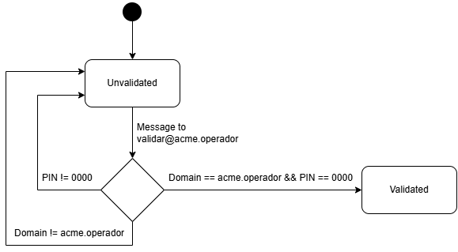
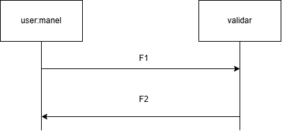

# US4 – Validação por PIN

**User story:** Como colaborador, quero validar o meu acesso com um PIN enviado por SIP MESSAGE, para aceder ao serviço de forma segura.

**Requisito (§2 do enunciado):** "O código PIN é enviado através de uma mensagem escrita (SIP MESSAGE) para o URI sip:validar@acme.operador (...) todos os utilizadores têm o PIN 0000 recebendo a resposta SIP 200, caso contrário recebem uma resposta SIP adequada."

## Acceptance Criteria

| # | Critério | Resultado |
| --- | --- | --- |
| AC1 | MESSAGE para sip:validar@acme.operador com corpo 0000 → 200 OK e utilizador marcado como validado | ✅ T1 |
| AC2 | MESSAGE com outro PIN → 403 Forbidden | ✅ T2 |
| AC3 | MESSAGE de utilizador externo → 403 Forbidden | ✅ T3 |

## Diagrama de estados



## Diagrama de sequência



## Transações e diálogos

Cada MESSAGE e a sua resposta final são identificadas pelo `branch` do Via (e pelo CSeq). O texto da mensagem é analisado quando o remetente é o `validar@acme.operador`, ou seja, existe diálogo entre o utilizador e o validar.

| Transação | Cenário | CSeq | Branch (Via) | Mensagens | Resposta final | Duração no servidor |
| --- | --- | --- | --- | --- | --- | --- |
| T1 | PIN correto | 365 | `z9hG4bKxbjbahrl` | F1–F2 | 200 OK | 69,95 ms |
| T2 | PIN errado | 861 | `z9hG4bKbrnddqdm` | F3–F4 | 403 Forbidden | 44,86 ms |
| T3 | PIN externo | 177 | `z9hG4bKnsmxlmuc` | F5–F6 | 403 Forbidden | 9,41 ms |

## Mensagens (capturas reais)

Valores retirados das capturas em `tests/US4/` (F1-F2 de `captura_PIN_correto.pcap`; F3–F4 de `captura_PIN_errado.pcap`; F5–F6 de `captura_PIN_externo.pcap`).

**F1** (captura_PIN_correto.pcap)
```
MESSAGE sip:validar@acme.operador SIP/2.0
Via: SIP/2.0/UDP 172.20.0.8;rport;branch=z9hG4bKxbjbahrl
Max-Forwards: 70
To: <sip:validar@acme.operador>	
From: "manel" <sip:manel@acme.operador>;tag=xsdmt
Call-ID: afyikpvphpvrokb@terminal.manel
CSeq: 365 MESSAGE
Content-Type: text/plain;charset=utf-8
User-Agent: Twinkle/1.11.0-devel
Content-Length: 4
0000
```
**F2** (captura_PIN_correto.pcap)
```
SIP/2.0 200 OK
Via: SIP/2.0/UDP 172.20.0.8;rport=5060;received=172.20.0.8;branch=z9hG4bKxbjbahrl
To: <sip:validar@acme.operador>;tag=b4f516ba9065625c22bc328d471b34f4.2bb60000	
From: "manel" <sip:manel@acme.operador>;tag=xsdmt
Call-ID: afyikpvphpvrokb@terminal.manel
CSeq: 365 MESSAGE
Server: kamailio (6.0.3 (x86_64/linux))
Content-Length: 0
```
**F3** (captura_PIN_errado.pcap)
```
MESSAGE sip:validar@acme.operador SIP/2.0
Via: SIP/2.0/UDP 172.20.0.8;rport;branch=z9hG4bKbrnddqdm
Max-Forwards: 70
To: <sip:validar@acme.operador>
From: "manel" <sip:manel@acme.operador>;tag=einyn
Call-ID: homopwagtqpilhy@terminal.manel
CSeq: 861 MESSAGE
Content-Type: text/plain;charset=utf-8
User-Agent: Twinkle/1.11.0-devel
Content-Length: 4
1234
```
**F4** (captura_PIN_errado.pcap)
```
SIP/2.0 403 Forbidden
Via: SIP/2.0/UDP 172.20.0.8;rport=5060;received=172.20.0.8;branch=z9hG4bKbrnddqdm
To: <sip:validar@acme.operador>;tag=b4f516ba9065625c22bc328d471b34f4.2bb60000
From: "manel" <sip:manel@acme.operador>;tag=einyn
Call-ID: homopwagtqpilhy@terminal.manel
CSeq: 861 MESSAGE
Server: kamailio (6.0.3 (x86_64/linux))
Content-Length: 0
```
**F5** (captura_PIN_externo.pcap)
```
MESSAGE sip:validar@acme.operador SIP/2.0
Via: SIP/2.0/UDP 172.20.0.5;rport;branch=z9hG4bKnsmxlmuc
Max-Forwards: 70
To: <sip:validar@acme.operador>
From: "joao" <sip:joao@outro.operador>;tag=uqfsv
Call-ID: kovebpwjnpzhvgz@terminal.joao
CSeq: 177 MESSAGE
Content-Type: text/plain;charset=utf-8
User-Agent: Twinkle/1.11.0-devel
Content-Length: 4
0000
```
**F6** (captura_PIN_externo.pcap)
```
SIP/2.0 403 Forbidden
Via: SIP/2.0/UDP 172.20.0.5;rport=5060;received=172.20.0.5;branch=z9hG4bKnsmxlmuc
To: <sip:validar@acme.operador>;tag=2ec2df97c6e302c39217a564efef54a5.750b0000
From: "joao" <sip:joao@outro.operador>;tag=uqfsv
Call-ID: kovebpwjnpzhvgz@terminal.joao
CSeq: 177 MESSAGE	
Server: kamailio (6.0.3 (x86_64/linux))
Content-Length: 0
```
