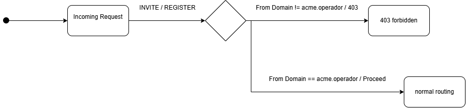
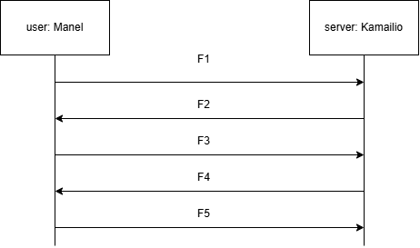

# US6 – Bloquear utilizadores externos: Acceptance Criteria e Definition of Done

**User story:** Como operador, quero bloquear utilizadores externos, para que só utilizadores de acme.operador usem o ConferenceControl 2.0.

**Requisito (§2 do enunciado):** "Utilizadores que não pertencem ao domínio acme.operador, ex. com o AoR sip:manel@outro.operador, não podem aceder a nenhuma funcionalidade do serviço."

## Acceptance Criteria

| # | Critério | Resultado |
| --- | --- | --- |
| AC1 | REGISTER de utilizador externo (`From` de outro domínio) → 403 Forbidden | ✅ T1 |
| AC2 | INVITE de utilizador externo para utilizador acme → 403 Forbidden (o ACK seguinte não tem resposta) | ✅ T2 |

## Diagrama de estados



## Diagrama de sequência



## Transações e diálogos

O REGISTER e a sua resposta formam **uma transação não-INVITE** (T1). O INVITE bloqueado forma **uma transação INVITE** (T2): o 403 é uma resposta final não-2xx, por isso o **ACK pertence à mesma transação** (mesmo `branch`) e **não é criado diálogo**. O Kamailio não responde ao ACK. A verificação é feita no início do `request_route`, por isso o pedido nunca chega às rotas de `REGISTER` e `INVITE`.

| Transação | Cenário | CSeq | Branch (Via) | Mensagens | Resposta final | Duração no servidor (pedido → resposta) |
| --- | --- | --- | --- | --- | --- | --- |
| T1 | REGISTER externo | 169 | `z9hG4bKrcxknzzi` | F1–F2 | 403 Forbidden | 11,58 ms |
| T2 | INVITE externo | 554 | `z9hG4bKzjdhoope` | F3–F5 | 403 Forbidden | 0,39 ms |

Na captura há ainda REGISTER repetidos de 30 em 30 s (CSeq 170 a 173), porque o Twinkle volta a tentar o registo. Têm o mesmo resultado (403) e não estão incluídos.

## Mensagens (capturas reais)

Valores retirados da captura em `tests/US6/` (F1–F2: pacotes 1–2; F3–F5: pacotes 9–11 de `captura_register_invite_bloqueados.pcap`).

**F1** (captura_register_invite_bloqueados.pcap)
```
REGISTER sip:outro.operador SIP/2.0
Via: SIP/2.0/UDP 172.20.0.8:5110;rport;branch=z9hG4bKrcxknzzi
Max-Forwards: 70
To: "Manel" <sip:manel@outro.operador>
From: "Manel" <sip:manel@outro.operador>;tag=gsqej
Call-ID: ppdlqhieoegdkmi@terminal.manel
CSeq: 169 REGISTER
Contact: <sip:manel@172.20.0.8:5110>;expires=3600
Allow: INVITE,ACK,BYE,CANCEL,OPTIONS,PRACK,REFER,NOTIFY,SUBSCRIBE,INFO,MESSAGE
User-Agent: Twinkle/1.11.0-devel
Content-Length: 0
```

**F2** (captura_register_invite_bloqueados.pcap)
```
SIP/2.0 403 Forbidden
Via: SIP/2.0/UDP 172.20.0.8:5110;rport=5110;received=172.20.0.8;branch=z9hG4bKrcxknzzi
To: "Manel" <sip:manel@outro.operador>;tag=d7c5775fc8bf047833cfcbc8dda76893.1245a8cb
From: "Manel" <sip:manel@outro.operador>;tag=gsqej
Call-ID: ppdlqhieoegdkmi@terminal.manel
CSeq: 169 REGISTER
Server: kamailio (6.0.3 (x86_64/linux))
Content-Length: 0
```

**F3** (captura_register_invite_bloqueados.pcap)
```
INVITE sip:maria@acme.operador SIP/2.0
Via: SIP/2.0/UDP 172.20.0.8:5110;rport;branch=z9hG4bKzjdhoope
Max-Forwards: 70
To: <sip:maria@acme.operador>
From: "Manel" <sip:manel@outro.operador>;tag=wrzlx
Call-ID: glofkrpsdutwjmp@terminal.manel
CSeq: 554 INVITE
Contact: <sip:manel@172.20.0.8:5110>
Content-Type: application/sdp
Allow: INVITE,ACK,BYE,CANCEL,OPTIONS,PRACK,REFER,NOTIFY,SUBSCRIBE,INFO,MESSAGE
Supported: replaces,norefersub,timer,100rel
User-Agent: Twinkle/1.11.0-devel
Content-Length: 249

v=0
o=twinkle 1397518325 680495650 IN IP4 172.20.0.8
s=-
c=IN IP4 172.20.0.8
t=0 0
m=audio 8030 RTP/AVP 8 0 3 101
a=rtpmap:8 PCMA/8000
a=rtpmap:0 PCMU/8000
a=rtpmap:3 GSM/8000
a=rtpmap:101 telephone-event/8000
a=fmtp:101 0-15
a=ptime:20
```

**F4** (captura_register_invite_bloqueados.pcap)
```
SIP/2.0 403 Forbidden
Via: SIP/2.0/UDP 172.20.0.8:5110;rport=5110;received=172.20.0.8;branch=z9hG4bKzjdhoope
To: <sip:maria@acme.operador>;tag=d7c5775fc8bf047833cfcbc8dda76893.3a1ccaa3
From: "Manel" <sip:manel@outro.operador>;tag=wrzlx
Call-ID: glofkrpsdutwjmp@terminal.manel
CSeq: 554 INVITE
Server: kamailio (6.0.3 (x86_64/linux))
Content-Length: 0
```

**F5** (captura_register_invite_bloqueados.pcap)
```
ACK sip:maria@acme.operador SIP/2.0
Via: SIP/2.0/UDP 172.20.0.8:5110;rport;branch=z9hG4bKzjdhoope
Max-Forwards: 70
To: <sip:maria@acme.operador>;tag=d7c5775fc8bf047833cfcbc8dda76893.3a1ccaa3
From: "Manel" <sip:manel@outro.operador>;tag=wrzlx
Call-ID: glofkrpsdutwjmp@terminal.manel
CSeq: 554 ACK
User-Agent: Twinkle/1.11.0-devel
Content-Length: 0
```
